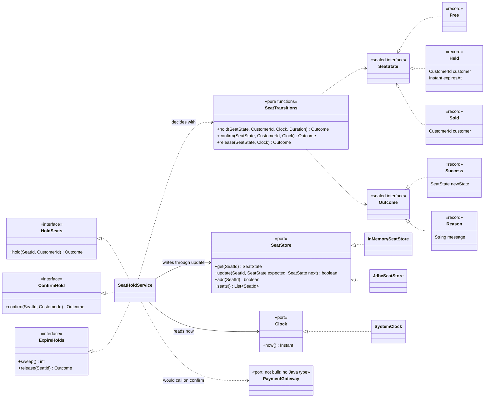
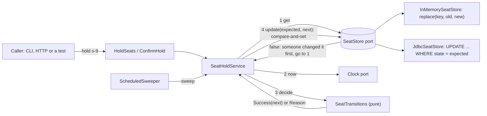

# Architecture

The seat-hold core of an event ticketing system. A seat is free, held for one customer for ten minutes, sold, or released when the hold expires. The domain decides what the next state should be; the storage port decides whether that decision may be written. The whole point is that "a seat is sold at most once" is guaranteed by the second, not the first.

**Pattern.** Hexagonal architecture (ports and adapters) around a data-oriented state machine. The hexagon is `domain` plus `application`: sealed state records, pure transition functions, the ports the domain owns (`SeatStore`, `Clock`) and the use cases that call them. Adapters live outside: an in-memory store, a PostgreSQL store, the system clock, a scheduler, and the command line. It fits because the system has two boundaries that must be replaceable (storage, time) and one rule that cannot live inside the hexagon (consistency under concurrency), which is exactly what a port with a compare-and-set contract is for.

## Components and what each owns

| Component | Layer | Owns |
| --- | --- | --- |
| `SeatState` (`Free`, `Held`, `Sold`) | domain | The three states, as sealed records; a `Held` keeps its expiry to the millisecond |
| `Outcome` (`Success`, `Reason`) | domain | A transition's answer: the next state or why not; never an exception |
| `SeatTransitions` | domain | `hold`, `confirm`, `release` as pure functions of the current state and a `Clock`; the one place that decides the expiry boundary |
| `SeatStore` (port) | domain | `get`, `update` (compare-and-set), `add`, `seats`. **The guarantee that a seat is sold at most once lives on `update`.** |
| `Clock` (port) | domain | The current time, injected so an expired hold is testable without waiting |
| `HoldSeats`, `ConfirmHold`, `ExpireHolds` | application (inbound ports) | What a caller wants to do; implemented by `SeatHoldService`, called by adapters, never calling out to one |
| `SeatHoldService` | application | Read, decide with a pure transition, write through `update`; on a lost write read again and decide again, at most five times |
| `HoldRace`, `SweepConfirmRace`, `RendezvousSeatStore` | application (`simulation`) | The lesson's two races as reusable drivers, used by the scenario, the command line and the tests |
| `InMemorySeatStore` | infrastructure | A `ConcurrentHashMap`; `replace(key, old, new)` is the atomic compare-and-set |
| `JdbcSeatStore`, `PostgresDataSource`, `DatabaseSettings` | infrastructure | One conditional `UPDATE`; a Hikari pool; validated settings whose `toString` hides the password |
| `PlainWriteSeatStore` | infrastructure | The counter-example: a plain write that always reports success. Never wired in; used by the scenario and one test |
| `SystemClock`, `ScheduledSweeper` | infrastructure | The real time; the periodic sweep with a clean shutdown |
| `Cli`, `Scenario`, `AppConfig`, `Application`, `Logging`, `Main` | interfaces | Parse arguments, read the environment, build the chosen store (the composition root), print results |

`PaymentGateway` is a named outbound port on the lesson's diagram with no adapter built in this project: confirming a hold would call it, and the lesson's slice stops at the state change. It has no Java type yet because an interface with no caller and no implementation would be speculation.

### Dependency rule

```text
interfaces ──► infrastructure ──► application ──► domain
     └──────────────┴────────────────┴─────────────► domain
```

The domain imports only `java..`, and not even `java.util.concurrent`: it has no locks and no threads because the guarantee is not there. The application imports the domain; infrastructure and interfaces import both; nothing imports `interfaces`; JDBC, Hikari and PostgreSQL types appear only in `infrastructure.jdbc`. `ArchitectureTest` enforces all of it.

## Class diagram

The names are the lesson's picture: the inbound ports `HoldSeats` and `ConfirmHold`, the seat transitions, the `Clock` port, the `SeatStore` port with its two adapters, and `PaymentGateway` as a named port with no adapter.



## Data flow

Drawn versions of this figure and of the walk-through: [the architecture](docs/diagrams/architecture.svg) and [one run](docs/diagrams/flow.svg).



### One run, step by step

A customer holds seat `s-9`, then confirms it, with another customer racing on the same seat:

1. The caller (the command line, a test, later an HTTP handler) calls `HoldSeats.hold(s-9, ada)`. The service has no rule of its own.
2. The service reads the seat through `SeatStore.get`: `Free[]`.
3. It calls the pure `SeatTransitions.hold(Free, ada, clock, 10 minutes)`. The clock says 00:00:00; the answer is `Success(Held(ada, 00:10:00))`. Nothing has been written.
4. It calls `SeatStore.update(s-9, Free, Held(ada, 00:10:00))`. In memory that is `replace(s-9, Free, Held)`; in PostgreSQL it is `UPDATE seats SET ... WHERE seat_id = 's-9' AND state_type = 'FREE' AND holder IS NOT DISTINCT FROM NULL AND ...`.
5. Bruno's identical call arrives between his read and his write. The first `update` to reach the store wins and returns true; the second matches no row (or no equal value) and returns false.
6. The loser's service loop reads the seat again: `Held(ada, ...)`. It decides again: `Reason("seat is held")`. That is returned to Bruno. (If the state changes under it again, it tries up to five times, then answers `Reason("seat is contended, try again")` rather than looping.)
7. Within ten minutes Ada calls `ConfirmHold.confirm(s-9, ada)`: read `Held(ada, 00:10:00)`, decide `Success(Sold(ada))` because the clock is not after the expiry, write through `update`. After the expiry the same call decides `Reason("hold expired")` and writes nothing. No payment is taken here: `PaymentGateway` has no Java type and nothing calls it; a real confirm would call it between deciding and writing.
8. Meanwhile `ScheduledSweeper` calls `ExpireHolds.sweep()` every `SWEEP_INTERVAL`. For each seat it reads, decides `release` (a hold is releasable only after its expiry), and writes through the same `update`. If a confirm and the sweep meet on one seat, both read the same `Held`, both decide a different, correct transition by their own clock, and only one `update` can match; the other re-reads, sees `Sold` or `Free`, and answers with a reason.

## Decisions and trade-offs

- **The guarantee lives in `SeatStore.update`** ([ADR 0001](docs/adr/0001-the-guarantee-lives-in-the-store.md)). Not in a domain record, not in a lock: a lock inside one JVM knows nothing about a second server, and a pure function has nothing to lock.
- **The conditional update compares the state, not a version** ([ADR 0002](docs/adr/0002-compare-the-state-not-a-version.md)). The port stays state-based; the `version` column is kept for auditing.
- **States are data and transitions are pure** ([ADR 0003](docs/adr/0003-seat-states-are-data-and-transitions-are-pure.md)). Every transition is a one-line test; concurrency is tested separately, at the store.
- **The expiry instant belongs to the customer.** A confirm at exactly `expiresAt` succeeds and a release is refused (`isAfter` for both), so at any instant exactly one of the two is allowed; a test sweeps the boundary millisecond by millisecond.
- **A bounded retry loop, not an unbounded one.** Five attempts, then a reason. Holds can cycle (Free, Held, Free) under a fast sweeper, so a loop with no bound could chase a changing seat forever.
- **Read again and decide again after a lost write,** instead of retrying the same write. A lost compare-and-set means the premise of the decision may be false; only a fresh decision is safe.
- **The database repeats the sealed type.** The `CHECK` constraint `seats_state_shape` allows exactly the three shapes (free: no holder, no expiry; held: both; sold: holder only), so a bug or a hand-run `UPDATE` cannot create a fourth.
- **Pooled connections as the concurrency limit.** A thousand virtual threads share a pool of sixteen connections; each `update` is one short statement, so the pool, not the database's connection limit, bounds the load.
- **No blind retry of a failed statement.** A connection error during `update` may leave the write committed; the adapter raises `SeatStoreException` and the caller decides. Startup does retry (the pool waits up to 30 seconds for a database that is still booting) and every connection request times out after 10 seconds.

## Failure modes the lesson teaches, and how the code shows them

| Failure | Where it is shown |
| --- | --- |
| A plain write instead of compare-and-set: two callers both win, the seat sells twice | `PlainWriteSeatStore`; `make run` prints `second update (stale expected): true  <- both were told they won seat s-9`; `PlainWriteSeatStoreTest` |
| A stale expected state is silently accepted | `SeatStoreContract.aStaleExpectedStateIsRejectedAndNothingChanges`, run against both adapters |
| A lock around the transitions is called the fix | There is nothing to lock in a pure function; `ArchitectureTest.theDomainHasNoLocksOrThreadsBecauseTheGuaranteeLivesInTheStore` fails the build if the domain imports `java.util.concurrent` |
| More than ten winners for ten seats | `HoldRaceTest` (in memory) and `JdbcHoldRaceIT` (PostgreSQL): 20 runs of 1,000 virtual threads, each exactly `wins=10 losses=990`; `make run` prints five |
| A race test where every thread owns its own seat proves nothing | `HoldRace` starts each customer at a different seat but has every customer try all seats, so threads collide on every seat |
| A confirm arriving at the same moment as the expiry sweep | `SweepConfirmRace` with a rendezvous inside the store makes both read before either writes; 100 repetitions in `SweepConfirmRaceTest` and `JdbcHoldRaceIT`, each ending `Sold` or `Free`, never both |
| An expired hold is confirmed because it is "the same customer" | `SeatTransitionsTest.confirmingAnExpiredHoldGivesAReasonNotASale` with a fixed clock |
| An impossible row in the database | `JdbcSeatStoreIT.theDatabaseItselfRefusesAnImpossibleSeat` |

## Limits of the teaching build against a production one

- **One event, ten seats, no seat map.** A real system models events, sections, and groups of seats held together (a pair of adjacent seats is one hold); holding several seats atomically needs a transaction or an ordered set of compare-and-sets with rollback.
- **No payment.** `ConfirmHold` turns a hold into a sale without charging anyone. The `PaymentGateway` port would be called between deciding and writing, and an idempotency key on confirm (the lesson's stretch goal) would keep a retried callback from selling twice.
- **Holds cannot be extended or cancelled by the customer.**
- **The sweeper scans every seat each time.** The partial index on held expiries suits `WHERE state_type = 'HELD' AND expires_at < now()` in SQL, but the port reads seats one at a time; at scale the store would offer "expired holds" as a query, or expiry would be checked on read.
- **Reasons are strings.** A reason code would let a web layer map them to status codes.
- **One database, no replicas.** A conditional update on a primary is atomic; reading from a replica to decide would make stale reads more likely and the compare-and-set would reject more often, which is safe but slower.
- **No metrics.** Counting holds, refusals and lost writes would be the first addition (the retry loop's lost-write count is the contention signal).

## How to extend it

- **A third adapter** (Redis with a Lua script, DynamoDB with a conditional write): implement `SeatStore` and extend `SeatStoreContract`; passing it is the whole acceptance test.
- **Idempotent confirm.** Add an idempotency key to `ConfirmHold.confirm` and store it with the sale; a replay with the same key returns the earlier result.
- **Expiry on read instead of a sweeper.** Make `get` treat a held seat past its expiry as free and let `hold` write over it through the same compare-and-set; compare the two designs with `HoldRace`.
- **HTTP.** A handler that calls `HoldSeats` and `ConfirmHold` is a new package under `interfaces`; run two instances against one database and repeat the race through HTTP to see the database arbitrate.
