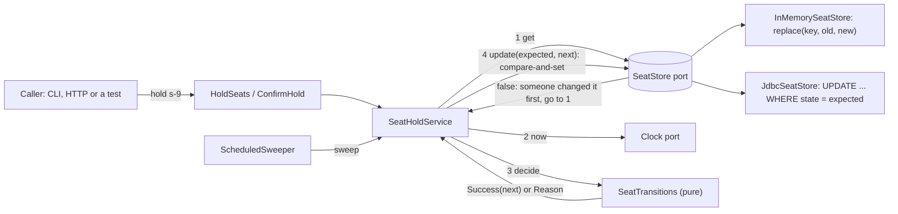

# Mermaid diagrams (in `ARCHITECTURE.md`)

## What it is

Mermaid is a way to draw diagrams by writing text. You write a few lines inside a code block marked `mermaid`, and a viewer that knows Mermaid (GitHub does) draws boxes and arrows from them. This repository uses two kinds: a **class diagram** (`classDiagram`, which shows types and how they relate) and a **flowchart** (`flowchart`, which shows how data moves).

## Why this repository uses it

The template asks for the class diagram "as Mermaid with the same names as the lesson's picture" and for a data-flow diagram in `ARCHITECTURE.md`. A text diagram lives in Git next to the code, shows up as a picture on GitHub, and can be changed in a normal commit.

## Where it appears

| Path | What it does with Mermaid |
| --- | --- |
| `ARCHITECTURE.md` | One `classDiagram` block and one `flowchart` block. The names are the lesson's: `HoldSeats`, `ConfirmHold`, `SeatStore`, `Clock`, `PaymentGateway`, the in-memory and JDBC adapters. |

## How it works underneath

Mermaid is a JavaScript library. When a page with a `mermaid` code block loads, the page's script reads the text, **parses** it into a graph of nodes and edges, lays the graph out, and draws the result as an SVG picture. Nothing is saved as an image file; the picture is rebuilt each time the page is shown. If the text has a syntax error, the viewer shows an error box instead of a picture, which is why every diagram here was checked with a Mermaid validator before it was committed.

## Walkthrough of this repository's use

### The flowchart



- `flowchart LR` says: a flowchart, laid out **L**eft to **R**ight.
- `id["Label"]` defines a node: `id` is the short name used in arrows, the text in `[" "]` is what the box shows. The shape of the brackets sets the shape of the box: `["..."]` is a rectangle, `[("...")]` is a cylinder (used for a store or database).
- `a --> b` draws an arrow from `a` to `b`. `a -->|text| b` puts text on the arrow. `a -.-> b` draws a dotted arrow.
- The text is the same data flow that the numbered walk-through in `ARCHITECTURE.md` explains.

### The class diagram

```mermaid
classDiagram
    direction LR
    class HoldSeats {
```

```SeatHoldService ..> PaymentGateway
HoldSeats <|.. SeatHoldService
```

- `classDiagram` starts a class diagram. `direction LR` lays it out left to right.
- `class Name { ... }` draws a box for a type. Lines inside list members; `<<record>>`, `<<interface>>`, `<<sealed interface>>` are **stereotypes**, labels above the name. `+name(args) Type` is a method with its return type; `Type name` alone is a field. `~Type~` is Mermaid's way of writing generics (`List~Booking~` is `List<Booking>`).
- The lines after the boxes are **relationships**: `A <|.. B` means B implements A (dotted line, hollow triangle), `A *-- B` means A is made of B (composition), `A o-- B` means A holds B (aggregation), `A --> B` means A uses B, `A ..> B` means A depends on B more loosely. Text after a colon labels the line.

## Try it yourself

1. Paste a diagram block from `ARCHITECTURE.md` into the live editor at <https://mermaid.live> to see the picture and edit it.
2. Change one arrow label in the editor and watch the picture update.
3. Break the syntax (delete a `]`) and see the error.
4. `grep -n 'mermaid' ARCHITECTURE.md` shows where each diagram block starts.
5. After pushing to GitHub, open `ARCHITECTURE.md` in the browser: both diagrams are drawn.

## Mistakes people make

- **A diagram that drifts from the code.** The names here match the real classes and the lesson's picture; update both together.
- **Special characters in labels** (`(`, `|`, `<`). Put the label in double quotes: `id["a (b)"]`.
- **Missing validation.** Mermaid reports errors only when a viewer renders it. Check diagrams before committing.
- **Too much in one diagram.** The class diagram shows relationships; the flowchart shows data flow; each is kept separate.
- **Forgetting the fence word.** Without `mermaid` after the backticks, GitHub shows plain text.

## Check yourself

1. *What does `flowchart LR` mean?* A flowchart laid out left to right.
2. *How do you label an arrow?* `a -->|label| b`.
3. *What does `A <|.. B` mean in a class diagram?* B implements A.
4. *How does GitHub show a Mermaid block?* It draws it as a diagram in the page.
5. *Why quote a label like `["Cli (command line)"]`?* Quotes let a label contain brackets and other special characters.

## Further reading

- Mermaid documentation (flowcharts, class diagrams): <https://mermaid.js.org/syntax/flowchart.html>, <https://mermaid.js.org/syntax/classDiagram.html>
- GitHub Docs, creating diagrams: <https://docs.github.com/get-started/writing-on-github/working-with-advanced-formatting/creating-diagrams>
